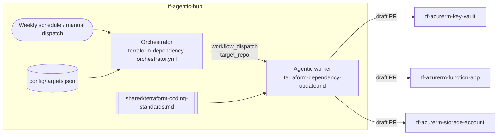

# tf-agentic-hub

Central automation hub that keeps a fleet of Terraform module repositories on current,
validated dependency versions. It implements the **MultiRepoOps** pattern of
[GitHub Agentic Workflows (gh-aw)](https://github.com/github/gh-aw): all automation lives in this
repository and the target repositories only receive pull requests – no workflow, secret or
configuration changes are required in them.

## Big picture



1. **Orchestrator** (`.github/workflows/terraform-dependency-orchestrator.yml`) – a plain, deterministic
   GitHub Actions workflow. It reads `config/targets.json` and dispatches one worker run per target
   repository. No AI is involved in the fan-out.
2. **Worker** (`.github/workflows/terraform-dependency-update.md`, compiled to `.lock.yml`) – an
   agentic workflow that, for exactly one target repository:
   1. checks out the target repository,
   2. inventories every Terraform **module reference** (Git `?ref=` tags and Registry `version`s) and the
      **`hashicorp/azurerm` provider** constraint – in code *and* documentation snippets,
   3. resolves the latest versions from GitHub releases and the Terraform Registry,
   4. upgrades outdated references and the azurerm constraint (following the official azurerm upgrade
      guide when a major version is crossed),
   5. validates every root/example configuration with `terraform fmt`, `terraform init -backend=false`
      and `terraform validate`,
   6. reviews the code against the shared **Terraform coding standards**,
   7. updates `README.md`, example READMEs and `CHANGELOG.md`,
   8. opens a single **draft pull request** prefixed with `[terraform-deps]` in the target repository –
      or reports a `noop` when everything is current or validation cannot be made green.
3. **Coding standards** (`.github/workflows/shared/terraform-coding-standards.md`) – a shared prompt
   component imported by the worker. Each standard is either auto-fixed in the PR (`fix`) or listed
   as a finding in the PR body (`report`).

### Coding standards

| ID     | Standard | Action |
|--------|----------|--------|
| TF-001 | `terraform fmt` clean | fix |
| TF-002 | `required_version` and pinned `required_providers` | fix |
| TF-003 | Module sources pinned to release tags / registry versions | fix |
| TF-004 | Variables have `description` and `type` | fix |
| TF-005 | Outputs have `description`, secrets are `sensitive` | fix |
| TF-006 | No hard-coded secrets or IDs, sensitive variables marked | report |
| TF-007 | Taggable resources receive a `tags` variable | report |
| TF-008 | Secure defaults (TLS 1.2, HTTPS only, no public access, purge protection, RBAC) | report |
| TF-009 | Standard module layout incl. `examples/` | report |
| TF-010 | README documents usage, inputs, outputs and versions | fix |

The standards file also contains an optional **README tone** instruction (TF-011) that is
commented out by default. HTML comments are stripped from the prompt at runtime, so the instruction
is inactive until you remove the surrounding `<!--` and `-->` markers.

### Guardrails

- The agent runs in the gh-aw sandbox with a network firewall limited to the `defaults`, `github`
  and `terraform` ecosystems and an allow-listed shell (`terraform`, `git`, `find`, `ls`, `cat`,
  `grep`, `sed`, `jq`, `diff` and the gh-aw default safe commands).
- The agent has **no repository write token**. Changes are handed to the separate `safe_outputs` job, which is
  the only job allowed to push a branch and open the pull request (max. one draft PR per run,
  `.terraform/`, state and plan files are excluded from the patch).
- The worker refuses to run for repositories that are not listed in `config/targets.json`.
- Pull requests are always drafts and require human review.

## Repository layout

```text
.
├── config/
│   └── targets.json                              # Target repositories (single source of truth)
└── .github/workflows/
    ├── terraform-dependency-orchestrator.yml     # Deterministic fan-out (schedule / manual)
    ├── terraform-dependency-update.md            # Agentic worker – source (edit this)
    ├── terraform-dependency-update.lock.yml      # Agentic worker – compiled (generated, do not edit)
    ├── shared/terraform-coding-standards.md      # Shared coding standards prompt
    └── agentics-maintenance.yml                  # Generated by gh-aw (do not edit)
```

## Setup

### 1. Prerequisites

- GitHub CLI and the gh-aw extension: `gh extension install github/gh-aw` (only needed to compile and operate the workflows)
- GitHub Actions enabled for this repository.
- The organization must have a Copilot subscription and centralized billing enabled under
  **Organization → Settings → Copilot → Policies → Copilot CLI → "Allow use of Copilot CLI billed to the organization"**.
  Inference consumes the organization's AI Credits; ensure its billing/budget permits usage.
  See the official [authentication](https://github.github.com/gh-aw/reference/auth/#copilot-requests-write-permission)
  and [billing](https://github.github.com/gh-aw/reference/billing/) guidance.

### 2. GitHub App and secrets

Create the following repository variable and secrets in the hub repository
(**Settings → Secrets and variables → Actions**):

| Type | Name | Value / used for |
|------|------|------------------|
| Variable | `APP_CLIENT_ID` | GitHub App Client ID for target repository access |
| Secret | `APP_PRIVATE_KEY` | Entire downloaded PEM private key, including BEGIN/END lines, for the App |

Give the GitHub App repository permissions `Contents: Read & write`,
`Pull requests: Read & write` and `Metadata: Read`.
Install it in `softwareone-public` using **Only select repositories**, selecting only the target
repositories and any private module-source repositories that must be readable
(`Contents: Read` is required for those sources).

The worker uses gh-aw's native `github-app` authentication for checkout, GitHub tools and safe
outputs, including the safe-output target checkout. gh-aw generates short-lived installation
tokens at runtime; do not store installation tokens as secrets. Read operations use read-scoped
tokens, while safe outputs receive the permissions needed to push branches and open PRs.
App tokens do not request Issue permissions; PR-to-issue fallback and diagnostic issue
creation are disabled. Diagnostics remain available in Actions logs and run summaries.
The configured `repositories: ["*"]` means repositories available to this App installation,
**not all organization repositories**. Keep the private key only in Secrets, never in Variables
or source code.

Copilot inference uses the built-in Actions `GITHUB_TOKEN` (`${{ github.token }}`) with
`copilot-requests: write`, billed to the organization. No Copilot PAT is required: the App
authorizes repository operations, **not inference**. The worker no longer uses an existing
`COPILOT_GITHUB_TOKEN` secret; an administrator may remove it if no other workflows need it.
Do not replace the Actions inference token with an App installation token.

```bash
gh aw secrets bootstrap   # interactive check of all secrets required by the compiled workflows
# set the variable and secrets individually
gh variable set APP_CLIENT_ID
gh secret set APP_PRIVATE_KEY < /path/to/downloaded-private-key.pem
```

### 3. Labels (optional)

The pull requests are labelled `dependencies`, `terraform` and `automated`. Create these labels
in the target repositories if you want them applied.

### 4. Register target repositories

Add or remove repositories in `config/targets.json`:

```json
{
  "repositories": [
    "softwareone-public/tf-azurerm-key-vault",
    "softwareone-public/tf-azurerm-function-app",
    "softwareone-public/tf-azurerm-storage-account"
  ]
}
```

No recompilation is needed after changing the target list.

## Operation

| Task | Command |
|------|---------|
| Run for all targets | `gh workflow run terraform-dependency-orchestrator.yml` |
| Run for all targets, minor/patch upgrades only | `gh workflow run terraform-dependency-orchestrator.yml -f allow_major_upgrades=false` |
| Run for a single target | `gh aw run terraform-dependency-update --raw-field target_repo=softwareone-public/tf-azurerm-key-vault` |
| Check status | `gh aw status` |
| Inspect a run | `gh aw logs terraform-dependency-update` / `gh aw audit <run-id>` |

The orchestrator also runs automatically every Monday at 06:00 UTC.

Each run produces one of the following outcomes per target repository:

- **Draft PR** `[terraform-deps] Update Terraform dependencies (...)` with a version change table,
  migration notes, validation results, the coding standards review and the updated documentation.
- **No-op** – everything is current, an identical `[terraform-deps]` PR is already open, or
  validation could not be made green (the reason is visible in the run summary).

## Customisation

| Change | Where | Recompile? |
|--------|-------|------------|
| Target repositories | `config/targets.json` | No |
| Agent instructions (prompt body) | `terraform-dependency-update.md` (below the frontmatter) | **Yes** – `gh aw compile` |
| Coding standards | `shared/terraform-coding-standards.md` | **Yes** – `gh aw compile` |
| Triggers, permissions, tools, network, safe outputs | Frontmatter of `terraform-dependency-update.md` | **Yes** – `gh aw compile` |
| Schedule / fan-out | `terraform-dependency-orchestrator.yml` | No |

### Enable the pirate README tone

1. Open `.github/workflows/shared/terraform-coding-standards.md`.
2. Remove the `<!--` and `-->` lines around the **README tone** section (TF-011).
3. Run `gh aw compile --strict`, commit and run the orchestrator. The next pull requests rewrite
   the README prose in pirate language while leaving code blocks, tables and identifiers untouched.

Restore the comment markers (and recompile) to turn it off again.

### Compile after changing a workflow `.md` file

```bash
gh aw compile --strict
git add .github/workflows/
git commit -m "Recompile agentic workflows"
```

Always commit the `.md` source together with the generated `.lock.yml`; the lock file records
hashes of the sources and gh-aw flags stale lock files at runtime.
The organization-billed worker is compiled with gh-aw v0.89.21, which supports
`copilot-requests: write`; no compiler upgrade is needed for this authentication mode.

## Troubleshooting

| Symptom | Likely cause |
|---------|--------------|
| `validate_target` job fails | `target_repo` is not listed in `config/targets.json`. |
| Checkout of the target repository fails | `APP_CLIENT_ID` variable or `APP_PRIVATE_KEY` secret missing/invalid, or the App is not installed on the target with `Contents: Read`. |
| App token creation fails with `The permissions requested are not granted to this installation` | The compiled workflow requests permissions the App installation does not grant. Keep unused `issues` permissions, PR-to-issue fallback and diagnostic issue creation disabled, then recompile. Verify the App installation grants the Contents and Pull requests permissions listed above. |
| Copilot inference is denied | Verify the organization's Copilot subscription, centralized CLI billing policy and available budget, and recompile/commit the worker with `copilot-requests: write`. The GitHub App cannot authorize inference. |
| `terraform init` fails with network errors | A module source points to a host outside the allowed network ecosystems – add it under `network.allowed` and recompile. |
| PR creation fails | The App lacks installation access or required write permissions on the target, or the target base branch differs from this repository's default branch (set `safe-outputs.create-pull-request.base-branch`). |
| Runs cancel each other | Ensure the worker keeps `concurrency.job-discriminator` set to the target repository. |
